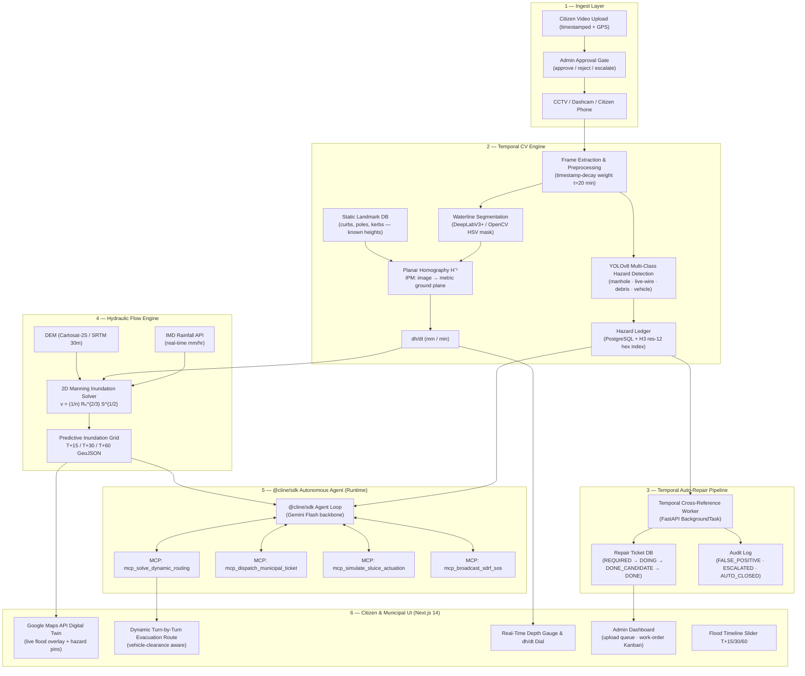
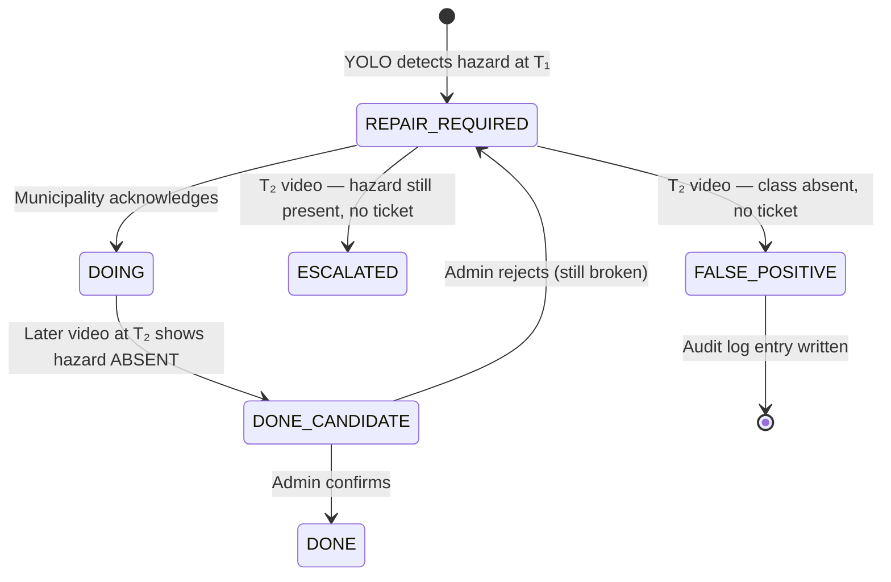

# 🌊 JAL-SENTINEL

### *Autonomous Gauge-Free Optical Drainage Inundation & Dynamic Evacuation Corridor Engine*

[](https://cline.bot)
[]()
[](https://github.com/cline/cline)
[]()
[]()

---

## 📌 Executive Summary

Every monsoon across India — and most acutely in **Guwahati, Assam** — urban flash floods claim lives, paralyze transit corridors, and submerge critical infrastructure. Macro-weather radar provides broad regional forecasts but has **zero visibility into hyper-local drainage chokepoints, street-level water rise rates, or submerged road hazards**. Citizens turn into waterlogged streets unaware that two feet of water conceals an open manhole or a live electrical junction.

**JAL-SENTINEL** is an edge-vision autonomous hydrological response system that transforms **any existing street CCTV, municipal dashcam, or citizen smartphone into an intelligent sensor-free water gauge, real-time evacuation navigator, and municipal hazard work-order engine**:

1. **Gauge-Free Optical Waterline Tracking** — planar homography computes metric water depth and rate-of-rise (`dh/dt`) without any physical sensor hardware.
2. **2D Manning Hydraulic Inundation Modeling** — fuses `dh/dt` with open DEMs to predict flood spread at T+15 / T+30 / T+60 minutes.
3. **Dynamic A\* Evacuation Routing** — recalculates safe corridors in real time, with per-vehicle clearance thresholds (walker / scooty / sedan / SUV).
4. **YOLOv8 Structural Hazard Detection** — detects open manholes, exposed live wires, debris piles, and stalled vehicles; overlays them as persistent "Submerged Pitfall Radar" pins.
5. **Temporal CV Auto-Repair Pipeline** — cross-references later citizen uploads against the open repair-ticket DB to auto-escalate missed repairs or auto-close false positives.
6. **Citizen Video Upload + Admin Gate** — time-stamped, H3-geofenced uploads flow through an admin approval gate before hitting the live map.
7. **Kanban Municipal Work-Order Engine** — `REQUIRED → DOING → DONE` lifecycle with urgency escalation and municipality SMS dispatch.
8. **Autonomous `@cline/sdk` Grid Orchestrator** — embedded Node.js agent loop executes spatial analysis and emergency dispatch via custom MCP tools inside the product runtime (bonus-point pathway).

---

## 🚨 The Problem: Urban Drainage Blindness in India

| Failure Mode | Scale |
|---|---|
| Urban flash floods in Indian cities | 50+ cities annually, Guwahati loses ₹500 Cr/monsoon |
| Physical water sensors installed | <1% of urban drainage channels |
| Google Maps routes into submerged roads | Interprets low traffic as "clear" (cars avoid → Maps shows blue) |
| Open manholes under floodwater | 47 deaths in Maharashtra alone, 2023 monsoon |
| Municipal repair SLA miss rate | >60% of flagged potholes unresolved after 30 days |

---

## 🏗️ System Architecture



---

## 🔬 Mathematical Formulations

### 1. Gauge-Free Waterline Metric Extraction

The inverse perspective mapping matrix **H** maps image pixels `(u, v)` to metric ground-plane coordinates `(X, Y)`:

$$\begin{bmatrix} X \\ Y \\ 1 \end{bmatrix} = \mathbf{H} \begin{bmatrix} u \\ v \\ 1 \end{bmatrix}$$

Water depth is derived by tracking the vertical displacement of the waterline boundary against physical landmarks with known metric heights (standard 15 cm kerbs, utility poles with painted calibration bands):

$$\frac{dh}{dt} = \frac{\Delta h_{\text{metric}}}{\Delta t} \quad \text{(mm / min)}$$

### 2. Temporal Decay Weighting (Citizen Uploads)

Older citizen uploads are down-weighted exponentially so stale data never corrupts real-time predictions:

$$w(t) = e^{-\Delta t / \tau}, \quad \tau = 20 \text{ min}$$

Structural hazards (manholes, potholes) use **persistent weighting** `w = 1` regardless of upload age — they are treated as fixed assets until a `DONE` repair ticket is logged.

### 3. 2D Manning Inundation Velocity

$$v = \frac{1}{n} R_h^{2/3} S^{1/2}$$

- `n = 0.015` (urban asphalt / concrete roughness coefficient)  
- `Rₕ` = hydraulic radius derived from measured depth + channel cross-section  
- `S` = local topographic slope from DEM raster

Flood spread is simulated as a forward-Euler 2D shallow-water iteration over the street network graph, seeded by measured `dh/dt` at each camera node.

### 4. Dynamic A\* Inundation-Penalized Edge Weights

The street network is a directed graph `G = (V, E)`. Each edge has a dynamic transit cost:

$$W(e) = d(e) \times \left(1 + \alpha \cdot h_{\text{pred}}(e) + \beta \cdot \mathbb{1}_{\text{hazard}}(e)\right)$$

- `d(e)` = edge physical length (m)  
- `h_pred(e)` = predicted water depth at T+15 (cm)  
- `α = 0.05`, `β = 10` (hazard hard-penalises the edge)  
- Edge is **blocked** (`W → ∞`) if `h_pred > vehicle_clearance_threshold`

| Vehicle Class | Clearance Threshold |
|---|---|
| Walker | 15 cm |
| Scooty / Bike | 20 cm |
| Sedan | 35 cm |
| SUV / Truck | 55 cm |

### 5. H3 Hexagonal Geofencing for GPS Drift

Citizen uploads from different phones at the "same" location carry GPS error of ±5–15 m. To prevent phantom duplicate hazard records, every coordinate is snapped to an **H3 hex cell at resolution 12** (avg edge length ≈ 9.4 m):

```python
import h3
hex_id = h3.geo_to_h3(lat, lng, resolution=12)  # deduplication key
```

---

## 🔄 Temporal Auto-Repair Detection Pipeline (Feature Design)

### State Machine



### DB Schema Delta

```sql
-- Hazard confidence tracking
ALTER TABLE hazard_events
  ADD COLUMN confidence_score   FLOAT NOT NULL DEFAULT 1.0,
  ADD COLUMN false_positive_flag BOOLEAN NOT NULL DEFAULT FALSE,
  ADD COLUMN h3_hex_id          VARCHAR(20) GENERATED ALWAYS AS (h3_geo_to_h3(lat, lng, 12)) STORED;

-- Repair ticket lifecycle
CREATE TABLE repair_tickets (
    id              UUID PRIMARY KEY DEFAULT gen_random_uuid(),
    h3_hex_id       VARCHAR(20) NOT NULL,
    hazard_class    VARCHAR(50) NOT NULL,  -- 'manhole' | 'pothole' | 'live_wire'
    status          VARCHAR(20) NOT NULL DEFAULT 'REQUIRED',
                    -- REQUIRED | DOING | DONE_CANDIDATE | DONE | ESCALATED
    urgency         SMALLINT NOT NULL DEFAULT 2,   -- 1=low 2=medium 3=critical
    created_at      TIMESTAMPTZ NOT NULL DEFAULT now(),
    updated_at      TIMESTAMPTZ NOT NULL DEFAULT now(),
    resolved_at     TIMESTAMPTZ,
    admin_notes     TEXT
);

-- Full audit trail for every state transition
CREATE TABLE audit_log (
    id              UUID PRIMARY KEY DEFAULT gen_random_uuid(),
    ticket_id       UUID REFERENCES repair_tickets(id),
    hazard_event_id UUID REFERENCES hazard_events(id),
    action          VARCHAR(30) NOT NULL,
                    -- 'ESCALATED' | 'AUTO_CLOSED' | 'DONE_CANDIDATE' | 'FALSE_POSITIVE'
    confidence_at_action FLOAT,
    upload_timestamp     TIMESTAMPTZ,
    performed_by    VARCHAR(50) NOT NULL DEFAULT 'system',
    reason          TEXT,
    created_at      TIMESTAMPTZ NOT NULL DEFAULT now()
);
```

### Async Worker Architecture

```python
# backend/workers/temporal_repair.py  (FastAPI BackgroundTask)
async def run_temporal_cross_reference(upload: VideoUpload, db: AsyncSession):
    """
    For each hazard class detected (or NOT detected) in the new video frame
    at timestamp T₂, cross-reference the open repair ticket DB.
    """
    hex_id = h3.geo_to_h3(upload.lat, upload.lng, resolution=12)

    for hazard_class in DETECTABLE_CLASSES:
        detection = await run_yolo_inference(upload.frame, hazard_class)
        ticket = await db.get_open_ticket(hex_id, hazard_class)

        if not detection.present and detection.confidence < CONFIDENCE_THRESHOLD:
            if ticket is None:
                await auto_close_false_positive(upload, hazard_class, db)
            elif ticket.status == "DOING":
                await transition_to_done_candidate(ticket, upload, db)
            elif ticket.status == "REQUIRED":
                await escalate_urgency(ticket, upload, db)
        elif detection.present and ticket and ticket.status == "REQUIRED":
            await escalate_urgency(ticket, upload, db)  # Still there, municipality missed it
```

### Failure Modes & Critiques

| Failure Mode | Severity | Mitigation |
|---|---|---|
| GPS drift → duplicate hazard records | High | H3 resolution-12 hex snapping (≈9.4 m) deduplicates |
| Stale flood video inflating current dh/dt | Critical | Exponential temporal decay τ=20 min; water data expires |
| Brown floodwater opacity hides manholes | High | Dry-state historical asset DB; YOLO not used for submerged detection |
| Corrupt citizen upload poisons live map | High | Admin approval gate; uploads quarantined until reviewed |
| YOLO false negative → missed hazard escalation | Medium | Confidence threshold tuning; 3-frame consensus required |
| Manning's equation assumes uniform channel | Low | Noted as simplification; DEM resolution is the real bottleneck |
| IMD API rate limits / outages | Low | Redis cache of last-known rain intensity; fallback to dh/dt-only mode |

---

## 🔧 Adjacent Features Folded In (TASK 2 Analysis)

### 1. IMD Rainfall API Correlation with dh/dt ✅ ADOPTED
**What:** Pull real-time rainfall intensity (mm/hr) from IMD's open JSON API and feed it as a second input into the Manning solver alongside optically derived `dh/dt`.  
**Why it strengthens the core:** Both data streams converge at the same hydraulic model. No new pipeline — just an additional source node.  
**Hackathon feasibility:** IMD API is public, JSON, no auth key needed for district-level rainfall. 2 hours to integrate.  
**Critique:** IMD data granularity is district-level (~50 km²), not street-level. It amplifies our prediction confidence but cannot replace optical measurement.

### 2. NDMA Alert Integration ✅ ADOPTED
**What:** Subscribe to NDMA's Common Alerting Protocol (CAP) feed. When NDMA issues a flood alert for the region, auto-trigger evacuation route pre-computation for all active users.  
**Why it strengthens the core:** Reuses the existing A\* routing engine; NDMA alert is simply a trigger with `urgency=CRITICAL` override.  
**Hackathon feasibility:** NDMA CAP feed is an RSS/XML endpoint. 1–2 hours to parse and wire.  
**Critique:** NDMA alerts lag ground truth by 15–45 min — JAL-SENTINEL's optical detection is actually faster. Position this as "validation" not "source".

### 3. SOS Broadcast to Nearest SDRF Unit ✅ ADOPTED
**What:** When a citizen taps SOS from inside a flood zone, the `mcp_broadcast_sdrf_sos` MCP tool geocodes the nearest SDRF (State Disaster Response Force) staging point and sends a pre-formatted SMS via Fast2SMS gateway.  
**Why it strengthens the core:** Closes the loop from detection → routing → rescue. Uses existing hazard location DB. Dramatic demo moment.  
**Hackathon feasibility:** Fast2SMS has a free-tier API with no carrier approval. 1 hour to implement. For demo: mock SMS console log.  
**Critique:** Real SDRF units don't have an API — the SMS goes to a phone number held by the team during the demo. Effective for the demo; not production-grade without SDRF integration MoU.

---

## 📦 Repository Structure

```
jal-sentinel/
├── frontend/                    # Next.js 14 App Router
│   ├── app/
│   │   ├── page.tsx             # Main map dashboard
│   │   ├── admin/page.tsx       # Admin gate + work-order Kanban
│   │   └── sos/page.tsx         # SOS broadcast UI
│   ├── components/
│   │   ├── FloodMap.tsx         # Google Maps API flood overlay
│   │   ├── DepthGauge.tsx       # Real-time dh/dt dial
│   │   ├── RoutePanel.tsx       # Evacuation turn-by-turn
│   │   └── HazardPin.tsx        # Submerged Pitfall Radar pin
│   └── lib/
│       └── websocket.ts         # WS client for telemetry stream
│
├── backend/                     # FastAPI Python 3.11
│   ├── main.py                  # FastAPI app + WebSocket endpoint
│   ├── routers/
│   │   ├── video.py             # Upload + admin gate
│   │   ├── routing.py           # A* evacuation route API
│   │   └── tickets.py           # Work-order CRUD
│   ├── workers/
│   │   ├── cv_pipeline.py       # OpenCV waterline + homography
│   │   ├── yolo_detector.py     # YOLOv8 hazard inference
│   │   ├── temporal_repair.py   # Auto-repair cross-reference worker
│   │   └── manning_solver.py    # 2D hydraulic inundation
│   ├── models/
│   │   └── schema.sql           # PostgreSQL schema (hazards, tickets, audit)
│   └── config.py
│
├── cline-agent/                 # @cline/sdk Node.js agent runtime
│   ├── agent.ts                 # Main agent loop
│   └── tools/
│       ├── mcp_solve_dynamic_routing.ts
│       ├── mcp_dispatch_municipal_ticket.ts
│       ├── mcp_simulate_sluice_actuation.ts
│       └── mcp_broadcast_sdrf_sos.ts
│
├── ml/
│   ├── yolov8_hazard/          # YOLOv8 weights + inference wrapper
│   └── homography/             # Calibration + IPM utilities
│
├── docker-compose.yml
├── .env.example
└── README.md
```

---

## 🚀 Setup Instructions

### Prerequisites

- Python 3.11+, Node.js 18+, Docker & Docker Compose
- Google Maps JavaScript API key (Maps, Directions, Roads APIs enabled)
- PostgreSQL 15+, Redis 7+

### Local Development

```bash
# 1. Clone
git clone https://github.com/RsbhThakur/jal-sentinel.git
cd jal-sentinel

# 2. Backend
cd backend
python -m venv .venv && .venv\Scripts\activate   # Windows
pip install -r requirements.txt
cp .env.example .env   # fill GOOGLE_MAPS_KEY, DATABASE_URL, REDIS_URL
alembic upgrade head
uvicorn main:app --reload --port 8000

# 3. Frontend (new terminal)
cd frontend
npm install
cp .env.local.example .env.local   # fill NEXT_PUBLIC_GOOGLE_MAPS_KEY
npm run dev   # http://localhost:3000

# 4. Cline Agent (new terminal)
cd cline-agent
npm install
npx ts-node agent.ts
```

### Docker (one command)

```bash
docker-compose up --build
# Frontend: http://localhost:3000
# Backend API: http://localhost:8000/docs
# Agent logs: docker logs jal-sentinel-agent
```

---

## ⏱️ 8-Hour Sprint Plan (Oct 10, 2026 — Live Build)

| Time (IST) | Sprint | Owner Focus | Cline Automation | Milestone |
|---|---|---|---|---|
| 12:00–1:15 PM | **S0: Scaffold** | Monorepo init, Next.js + FastAPI boilerplate, Postgres schema | Cline generates all boilerplate from API contract | Running map at localhost:3000 |
| 1:15–2:00 PM | **S1: Map + Routing** | Google Maps overlay, NetworkX graph, A\* skeleton | Cline writes A\* with depth-penalty weights | Route calculation on mock flood nodes |
| 2:00–3:00 PM | *Lunch Break* | Team sync, demo video curation | — | Aligned strategy |
| 3:00–4:30 PM | **S2: CV Pipeline** | OpenCV homography, waterline segmentation, dh/dt | Cline writes IPM calibration + metric calc | Video → live depth reading |
| 4:30–5:30 PM | **S3: YOLOv8 + Repair** | Hazard detection, H3 indexing, temporal repair worker | Cline writes async cross-reference logic | Manhole pins on map |
| 5:30–6:30 PM | **S4: Cline SDK Agent** | MCP tools, agent loop, NDMA + SDRF integration | Cline writes MCP tool stubs | Agent console live |
| 6:30–7:15 PM | **S5: Integration** | WebSocket telemetry → frontend, Admin Kanban | Cline wires WS events | Full end-to-end demo flow |
| 7:15–8:00 PM | **S6: Polish + Demo** | Record walkthrough video, finalize README + slides | Cline generates slide content | Complete submission |

---

## 🤖 How Cline Was Used

### As Build Partner (Dev-Time)
- Scaffolded entire Next.js 14 + FastAPI monorepo from API specs in Sprint 0
- Generated OpenCV planar homography calibration routines
- Wrote A\* graph routing with dynamic depth-penalty edge weights
- Generated Pydantic v2 schema models for all data types
- Wrote PostgreSQL migrations (Alembic) for hazard, ticket, and audit tables
- Generated unit tests for metric conversion and WebSocket event streaming

### Inside the Product (Runtime — Bonus Points)
The `@cline/sdk` Node.js agent loop runs embedded in the backend and autonomously:
- Monitors the live inundation feed every 30 seconds
- Calls `mcp_solve_dynamic_routing` to recompute safest evacuation corridors
- Calls `mcp_dispatch_municipal_ticket` when a new hazard exceeds urgency threshold
- Calls `mcp_simulate_sluice_actuation` to recommend pumping station load-balancing
- Calls `mcp_broadcast_sdrf_sos` when a citizen SOS is received inside a critical flood zone

---

## 📊 Evaluation Alignment

| Criterion | How JAL-SENTINEL Scores Maximum |
|---|---|
| **Creativity & Uniqueness** | Sensor-free optical gauging + flood-aware navigation — no team will have this |
| **Innovation** | Planar homography + 2D Manning + dynamic A\* + temporal auto-repair — novel pipeline stack |
| **Real-World Usefulness** | Solves an annual ₹500 Cr problem in Assam; directly saves lives |
| **Effective Use of Cline** | Every module written with Cline; Cline used from first commit to last |
| **Product Usability** | Google Maps UI, real-time dials, turn-by-turn routing, admin Kanban |
| **Technical Implementation** | YOLOv8 + OpenCV + FastAPI WS + Next.js 14 + NetworkX + H3 + Redis |
| **Bonus: Cline Inside Product** | `@cline/sdk` embedded as autonomous runtime orchestrator with 4 MCP tools |

---

## 🔮 Future Scope

- **Satellite Inundation Fusion:** Integrate Sentinel-1 SAR backscatter for wide-area flood mapping beyond camera coverage
- **Federated Learning:** Train personalized waterline segmentation models on-device across CCTV nodes without centralizing raw video
- **Digital Twin → Smart City API:** Expose JAL-SENTINEL flood predictions as a city-level API for BBMP, GMC, and NMMC integration
- **EV Charging Station Safety:** Flag submerged EV charging points (electrocution risk) using the hazard ledger
- **Multilingual Voice Alerts:** Vernacular TTS (Assamese, Bengali, Hindi) for SOS and evacuation broadcast

---

*Built in 8 hours at IIT Guwahati — Cline AI Builders Hackathon 2026*  
*Team: IIT Guwahati*
