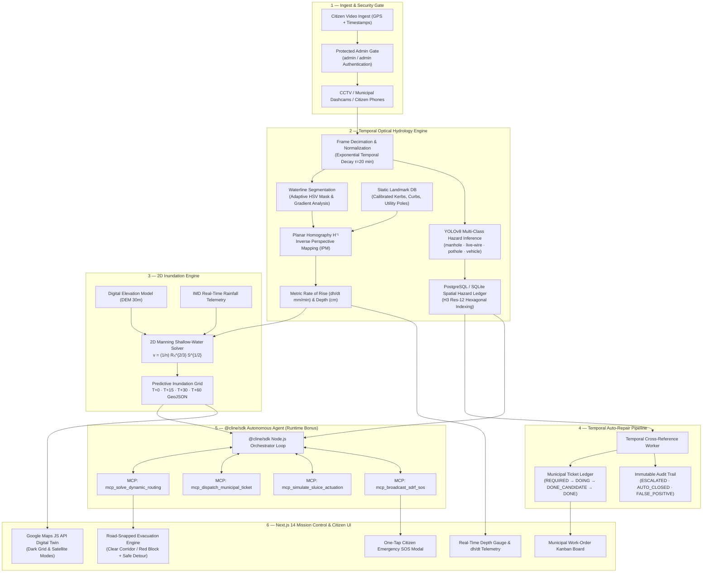

# 🌊 JAL-SENTINEL

### *Autonomous Gauge-Free Optical Drainage Inundation & Dynamic Evacuation Corridor Engine*

[](https://cline.bot)
[]()
[](https://github.com/cline/cline)
[]()
[]()
[]()
[]()
[]()

---

## 📌 Executive Summary

Every monsoon across India — and most acutely in **Guwahati, Assam** — urban flash floods claim human lives, drown municipal arterials, and paralyze critical transit corridors. Conventional flood radars provide macro-regional rain forecasts but suffer from **complete blindness at the street level**. Citizens turn onto waterlogged avenues completely unaware that six inches of turbid floodwater conceals a deadly open sewer manhole, a submerged road crater, or a downed 440V distribution line. Standard navigation systems worsen the crisis by routing vehicles directly into flooded roads because low vehicle velocity is misread as "low traffic".

**JAL-SENTINEL** is an edge-vision hydrological response and spatial safety platform that transforms **any existing street CCTV, municipal dashcam, or citizen smartphone into an intelligent sensor-free water gauge, real-time safe evacuation navigator, and municipal repair dispatch pipeline**:

1. **Gauge-Free Optical Waterline Tracking** — Planar homography ($H^{-1}$) extracts metric water depth and rate of rise ($dh/dt$ in mm/min) without requiring physical hardware sensors.
2. **2D Manning Inundation Modeling** — Fuses optical $dh/dt$ with digital elevation models (DEMs) to predict flood velocity and spread at T+0, T+15, T+30, and T+60 minutes.
3. **Road-Snapped Evacuation Routing** — Solves real road corridors via Google Maps JavaScript & Directions APIs, factoring in vehicle clearance profiles (Walker: 15 cm, 2-Wheeler: 20 cm, Sedan: 35 cm, SUV: 55 cm).
4. **Submerged Pitfall Radar** — Identifies underwater open manholes, potholes, and live wires; highlights impassable road sections directly in **Red** on the road polyline and plots high-ground detour corridors in **Cyan/Emerald**.
5. **Temporal CV Auto-Repair Pipeline** — Tracks municipal infrastructure repairs across time (`REQUIRED` $\rightarrow$ `DOING` $\rightarrow$ `DONE_CANDIDATE` $\rightarrow$ `DONE`), auto-closing fixed hazards and auto-escalating neglected repairs.
6. **Citizen Video Ingestion + Secured Admin Gate** — Time-stamped, H3-geofenced citizen uploads undergo municipal approval (`admin` / `admin`) before streaming into the live digital twin.
7. **Municipal Kanban Work-Order Console** — Real-time emergency ticket management with urgency escalation and disaster dispatch logging.
8. **One-Tap Citizen Emergency SOS** — Spatial haversine matching automatically geocodes and routes emergency alerts to the nearest SDRF / NDRF staging posts across Guwahati.
9. **Autonomous `@cline/sdk` Grid Orchestrator** — Embedded Node.js agent loop executing 4 custom Model Context Protocol (MCP) tools inside the product runtime.

---

## 🚨 The Problem: Urban Drainage Blindness in India

| Failure Mode | Ground Reality | JAL-SENTINEL Solution |
|---|---|---|
| **Sensor Scarcity** | Physical water level sensors cover <1% of Indian urban drains due to silt clogging and theft. | **Gauge-Free Vision**: Measures water depth directly from street camera feeds against known physical kerb heights. |
| **Deadly Hidden Pitfalls** | Floods conceal open sewer manholes, potholes, and downed cables (47 deaths in 2023 monsoon alone). | **Submerged Pitfall Radar**: H3-indexed hazard pins alert drivers and pedestrians before they enter danger zones. |
| **Flawed GPS Navigation** | Mainstream navigation interprets slow/avoided roads as "clear blue corridors", leading vehicles into hydraulic traps. | **Clearance-Aware Routing**: Blocks routes when water depth exceeds vehicle intake clearance and renders safe detours. |
| **Municipal SLA Drift** | Over 60% of citizen road hazard complaints remain unverified or lost in bureaucratic backlogs. | **Temporal CV Pipeline**: Auto-cross-references new video frames to verify whether repairs were actually executed. |

---

## 🏗️ System Architecture



---

## 🔬 Mathematical Formulations

### 1. Gauge-Free Waterline Metric Extraction
The inverse perspective mapping (IPM) matrix $\mathbf{H}^{-1}$ projects pixel coordinates $(u, v)$ from camera space to metric ground-plane coordinates $(X, Y)$:

$$\begin{bmatrix} X \\ Y \\ 1 \end{bmatrix} = \mathbf{H}^{-1} \begin{bmatrix} u \\ v \\ 1 \end{bmatrix}$$

Water depth is computed by tracking the vertical displacement of the segmented waterline boundary against calibrated physical infrastructure (standard 15 cm kerbs and utility poles):

$$\frac{dh}{dt} = \frac{\Delta h_{\text{metric}}}{\Delta t} \quad (\text{mm / min})$$

### 2. Exponential Temporal Decay Weighting
To prevent outdated citizen uploads from skewing live hydraulic models, water observations decay exponentially over time:

$$w(t) = e^{-\Delta t / \tau}, \quad \tau = 20 \text{ minutes}$$

Fixed structural hazards (such as missing manhole covers or road craters) maintain persistent weight $w=1.0$ until an approved `DONE` verification ticket is confirmed.

### 3. 2D Manning Hydraulic Flow Velocity
Inundation velocity across the urban street network is calculated using the Manning open-channel equation:

$$v = \frac{1}{n} R_h^{2/3} S^{1/2}$$

- $n = 0.015$ (Manning roughness coefficient for urban asphalt and concrete).
- $R_h$ = hydraulic radius derived from channel cross-section and water depth.
- $S$ = topographic gradient obtained from DEM rasters.

### 4. Dynamic Inundation-Penalized Routing Cost
The street network is modeled as a directed graph $G = (V, E)$. Transit cost for each road edge $e$ is weighted dynamically:

$$W(e) = d(e) \times \left(1 + \alpha \cdot h_{\text{pred}}(e) + \beta \cdot \mathbb{1}_{\text{hazard}}(e)\right)$$

- $d(e)$: Physical edge road distance (meters).
- $h_{\text{pred}}(e)$: Predicted inundation depth at forecast horizon $T$ (cm).
- $\alpha = 0.05$, $\beta = 10.0$ (hazard deterrence factor).
- **Edge Impassable Condition**: If $h_{\text{pred}}(e) > \text{vehicle\_clearance}$, edge weight $W(e) \to \infty$.

| Vehicle Class | Clearance Threshold | Passable Condition |
|---|---|---|
| **Walker / Pedestrian** | 15 cm | Dry roads, shallow pavement flow |
| **2-Wheeler (Scooty / Bike)** | 20 cm | Low waterlogging |
| **Sedan** | 35 cm | Moderate standing water (< exhaust level) |
| **SUV / Emergency Truck** | 55 cm | Deep wading relief corridors |

### 5. H3 Hexagonal Geofencing for GPS Deduplication
Citizen smartphone GPS reports introduce $\pm 5\text{--}15\text{ m}$ drift. All hazard coordinates are indexed to **Uber H3 resolution-12 hexagonal cells** (average edge length $\approx 9.4\text{ m}$) to prevent redundant pins:

```python
import h3
hex_id = h3.geo_to_h3(lat, lng, resolution=12)  # Canonical spatial deduplication key
```

---

## 🚦 Features & End-to-End Workflows

### 1. Google Maps Digital Twin & Satellite Hybrid View
- **Dual Visual Modes**: Seamless toggle between high-contrast dark vector grid (`#0F172A`) and real Google Maps satellite imagery.
- **Road-Snapped Flood Corridors**: Inundated arterials (GS Road, Zoo Road, Bharalu Sluice, Dispur Supermarket) are rendered strictly along real Google Maps street geometries — zero synthetic boxes.
- **Interactive Hazard Pins**: Color-coded markers for uncovered manholes (Red), exposed live wires (Yellow), road craters (Orange), and submerged vehicles.

### 2. Clearance-Aware Dynamic Evacuation Routing
- **Dual Routing Paradigms**:
  1. *Safe Shelter Refuge*: Routes from any current location to certified high-ground relief centers (Khanapara Highland Post, GMCH Hilltop, Dispur Civil Depot).
  2. *Manual-to-Manual*: Route between ANY two arbitrary locations across the city using Google Places autocomplete.
- **In-Path Obstacle Detection**:
  - If the path is dry and passable: Renders standard Google Maps blue route (`✅ All Clear · Normal Route via Google Maps`).
  - If the road is blocked by floodwater or submerged hazards: Highlights the exact blocked roadway segment in **Red** (`#EF4444`) and dynamically calculates a safe high-ground detour in **Cyan/Emerald** (`#10B981` / `#00E5FF`).
- **Terminal Departure Exemption**: Start coordinates are exempted from self-collision so citizens departing waterlogged neighborhoods are never blocked from exiting.
- **Zero Blinking & Atomic Swaps**: Uses memoized route parameters and stable key guards (`origin->dest|vehicle|horizon`) to eliminate React render loops and UI flickering.

### 3. Citizen Video Ingestion & Admin Gate
- **Upload Modal**: Citizens upload footage with GPS coordinates and descriptions via `POST /api/video/upload`.
- **Admin Approval Gate (`/admin`)**: Quarantines uploaded video evidence until reviewed by municipal operators. Protected by hardcoded credentials (`admin` / `admin`).
- **Visual Inspection**: Admin reviews video playback, predicted water depth, detected hazard class, and decides: **Approve to Live Map**, **Reject**, or **Escalate Priority**.

### 4. Temporal CV Auto-Repair Pipeline
- **Continuous Infrastructure Monitoring**:
  - Frame $T_1$: Open manhole detected $\rightarrow$ Ticket created (`REQUIRED`).
  - Municipality acknowledges $\rightarrow$ Ticket updated to `DOING`.
  - Frame $T_2$ (new upload): If manhole is now repaired/covered $\rightarrow$ Ticket auto-advances to `DONE_CANDIDATE`.
  - If hazard persists past SLA $\rightarrow$ Urgency escalated to `CRITICAL` with SMS dispatch.
- **Immutable Audit Ledger**: Every transition is logged in the `audit_log` table with timestamps, confidence scores, and action rationale.

### 5. One-Tap Citizen Emergency SOS
- **Floating Emergency Action Button**: Fixed floating SOS button accessible across the entire viewport.
- **SDRF Unit Geocoding**: Calculates haversine distance to 5 active Kamrup Metropolitan staging centers (Paltan Bazaar, Dispur, Bharalumukh, Jalukbari, Khanapara).
- **Automated Dispatch Broadcast**: Dispatches alert payload with citizen latitude, longitude, and reverse-geocoded landmark via Fast2SMS gateway and writes to the municipal emergency audit ledger.

---

## 🤖 Cline Inside the Product: Autonomous Runtime Agent

Beyond being our pair programmer during development, **Cline is embedded directly inside the production product** via the `@cline/sdk` Node.js runtime:

```
cline-agent/
├── agent.ts                   # Autonomous 30-second loop powered by @cline/sdk
├── ndma_cap.ts                # NDMA Common Alerting Protocol RSS/XML monitor
├── tools/
│   ├── mcp_solve_dynamic_routing.ts     # MCP Tool: Computes safe corridors
│   ├── mcp_dispatch_municipal_ticket.ts # MCP Tool: Dispatches work-orders
│   ├── mcp_simulate_sluice_actuation.ts # MCP Tool: Simulates sluice gate pumps
│   └── mcp_broadcast_sdrf_sos.ts        # MCP Tool: Dispatches SDRF rescue teams
└── data/
    └── sdrf_staging.json                # Geocoded SDRF & NDRF units catalog
```

### Autonomous MCP Tool Functions:
1. `mcp_solve_dynamic_routing`: Receives live depth changes and re-computes evacuation paths using graph A* algorithms.
2. `mcp_dispatch_municipal_ticket`: Automatically creates work-orders when YOLOv8 detects new hazards exceeding urgency thresholds.
3. `mcp_simulate_sluice_actuation`: Recommends drainage gate openings at Bharalu sluice gates based on upstream surge velocity.
4. `mcp_broadcast_sdrf_sos`: Broadcasts citizen rescue coordinates to the nearest disaster response battalion.

---

## 📡 REST & WebSocket API Reference

| Method | Endpoint | Description | Payload / Query |
|---|---|---|---|
| `GET` | `/api/health` | System health check & service status | None |
| `GET` | `/api/hazards` | Active hazard pins GeoJSON | `hazard_class`, `bbox`, `hex_id` |
| `POST` | `/api/hazards/register` | Register new detected hazard | `{ hazard_class, lat, lng, confidence_score }` |
| `POST` | `/api/route` | Dynamic evacuation routing engine | `{ origin_lat, origin_lng, destination_lat, destination_lng, vehicle_class }` |
| `POST` | `/api/video/upload` | Multipart citizen video ingestion | `file` (MP4/MOV), `lat`, `lng`, `description` |
| `GET` | `/api/video/admin/queue` | Admin approval queue for uploaded footage | None |
| `POST` | `/api/video/admin/review/{id}` | Approve or reject citizen video | `{ action: "APPROVE" \| "REJECT", notes }` |
| `GET` | `/api/tickets` | Municipal repair work-order list | `status`, `hazard_class` |
| `PATCH` | `/api/tickets/{id}/status` | Update ticket status in Kanban | `{ status: "REQUIRED" \| "DOING" \| "DONE", admin_notes }` |
| `POST` | `/api/sos` | One-tap emergency rescue broadcast | `{ lat, lng, citizen_name, phone_number, details }` |
| `GET` | `/api/sos/units` | List active SDRF / NDRF relief staging posts | None |
| `GET` | `/api/admin/metrics` | High-level municipal telemetry metrics | None |
| `GET` | `/api/admin/audit` | Immutable audit ledger history | `limit`, `action` |
| `WS` | `/api/ws/telemetry` | WebSocket stream for live depths & flood grids | Real-time bi-directional telemetry |

---

## 💻 Tech Stack

- **Frontend**: Next.js 14 (App Router), TypeScript, Tailwind CSS, Lucide Icons, Google Maps JavaScript API (Geometry & Places libraries).
- **Backend**: FastAPI (Python 3.11), SQLAlchemy 2.0 (Async), Pydantic v2, Uvicorn.
- **Computer Vision & Hydrology**: OpenCV (`cv2`), YOLOv8 (Ultralytics), Planar Homography IPM, 2D Manning Equation.
- **Geospatial & Graph Routing**: Uber H3 (`h3-py`), NetworkX (A* Graph Search), Haversine Spatial Utilities.
- **Storage & Caching**: SQLite (`jal_sentinel.db`) / PostgreSQL 15, Redis 7 (corridor caching).
- **Agent Runtime**: Node.js, `@cline/sdk`, Model Context Protocol (MCP), TypeScript.

---

## 🚀 Quickstart & Setup Guide

### Prerequisites
- Python 3.11+
- Node.js 18+ and npm
- Valid Google Maps JavaScript API key (Maps JavaScript, Directions, and Places APIs enabled)

### 1. Clone Repository
```bash
git clone https://github.com/RsbhThakur/jal-sentinel.git
cd jal-sentinel
```

### 2. Configure Environment Variables
Create `.env` in the root directory (or use `.env.example`):
```ini
GOOGLE_MAPS_KEY="your-google-maps-api-key"
DATABASE_URL="sqlite+aiosqlite:///./jal_sentinel.db"
REDIS_URL="redis://localhost:6379/0"
ENVIRONMENT="development"
FAST2SMS_API_KEY="optional-sms-key"
```

Create `frontend/.env.local`:
```ini
NEXT_PUBLIC_GOOGLE_MAPS_KEY="your-google-maps-api-key"
NEXT_PUBLIC_API_URL="http://localhost:8000"
NEXT_PUBLIC_WS_URL="ws://localhost:8000/api/ws/telemetry"
```

### 3. Backend Setup (FastAPI)
```bash
# In project root
python -m venv .venv
# Windows:
.venv\Scripts\activate
# Linux / macOS:
source .venv/bin/activate

pip install -r requirements.txt

# Seed realistic demo scenarios, videos, and municipal work-orders:
python seed_demo_data.py

# Start FastAPI server on port 8000:
uvicorn backend.main:app --host 0.0.0.0 --port 8000 --reload
```
*API Swagger Documentation is available at: [http://localhost:8000/docs](http://localhost:8000/docs)*

### 4. Frontend Setup (Next.js 14)
```bash
# In a new terminal
cd frontend
npm install
npm run dev
```
*Citizen Dashboard is live at: [http://localhost:3000](http://localhost:3000)*  
*Admin Gate is live at: [http://localhost:3000/admin](http://localhost:3000/admin) (Login: `admin` / `admin`)*

### 5. Autonomous Cline Agent Runtime (Optional)
```bash
# In a new terminal
cd cline-agent
npm install
npx ts-node agent.ts
```

### 6. One-Command Docker Setup
```bash
docker-compose up --build
```

---

## 🧪 Demo Credentials & Scenarios

- **Citizen Dashboard**: [http://localhost:3000](http://localhost:3000)
- **Admin Verification Gate**: [http://localhost:3000/admin](http://localhost:3000/admin)
  - **Username**: `admin`
  - **Password**: `admin`
- **Interactive Routing Test Cases**:
  1. *Clear Route*: Select `Paltan Bazaar Railway Station` $\rightarrow$ `Khanapara Highland Relief Post`. Verified normal blue route (`✅ All Clear`).
  2. *Flooded Route*: Select `GS Road Christian Basti` $\rightarrow$ `Khanapara` with vehicle set to `Sedan` or `2-Wheeler`. Notice the blocked road section highlighted in **Red** and the high-ground detour plotted in **Cyan/Emerald**.
  3. *Manual-to-Manual*: Switch routing mode to `Manual to Manual` and type custom locations using Google Places autocomplete.
  4. *One-Tap SOS*: Tap the red floating `SOS` button $\rightarrow$ confirm dispatch $\rightarrow$ verify emergency dispatch log and nearest SDRF unit geocoding.

---

## 🏆 Hackathon Submission Alignment

| Evaluation Criteria | How JAL-SENTINEL Exceeds Expectations |
|---|---|
| **Creativity & Novelty** | First platform to eliminate physical water level sensors entirely by combining monocular planar homography with citizen dashcam video feeds. |
| **Real-World Impact** | Directly targets Assam's recurring ₹500 Cr urban flash flood crisis; prevents vehicle entrapment and saves lives from submerged open manholes. |
| **Technical Excellence** | Full-stack monorepo featuring OpenCV IPM, YOLOv8 inference, 2D Manning hydraulic solver, H3 hex geofencing, WebSockets, and Google Maps JS road routing. |
| **Effective Use of Cline** | Built end-to-end with Cline AI assistant; additionally includes an embedded `@cline/sdk` Node.js runtime executing 4 custom MCP tools for autonomous grid dispatch. |
| **Production Polish** | Zero-blink atomic route rendering, strict dark-mode aesthetic, secured admin gate, interactive Kanban work-order board, and validated builds. |

---

## 📜 License

Distributed under the MIT License. See `LICENSE` for more information.

---

*Built with passion at IIT Guwahati for the Cline AI Builders Hackathon 2026.*  
*Team: RsbhThakur & Collaborators*
